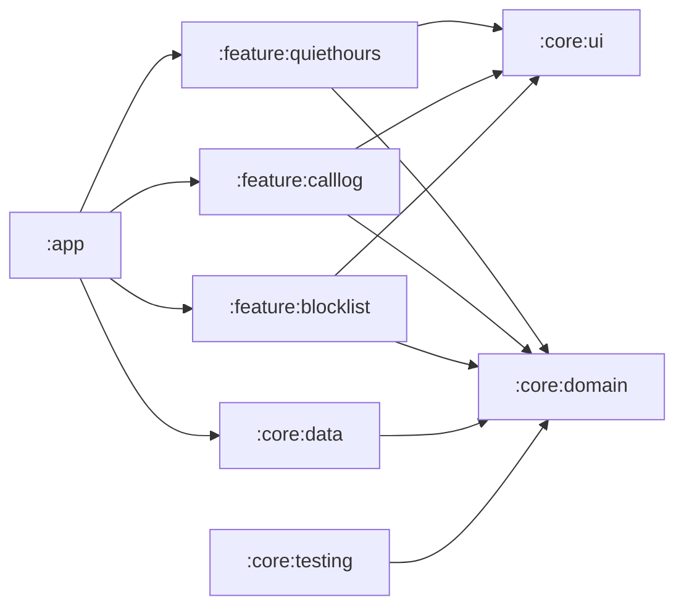
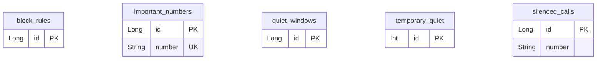
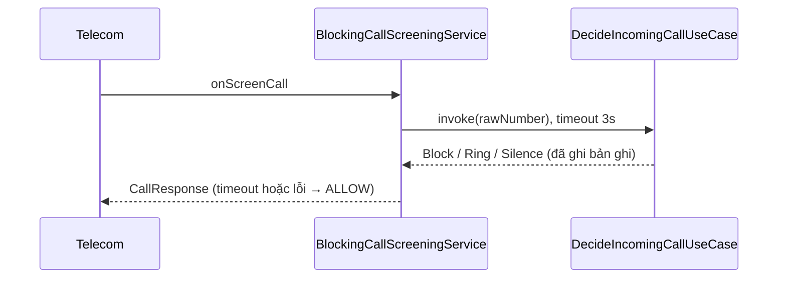

# Architecture Spine — Giờ yên tĩnh

## Design Paradigm

Giữ nguyên kiến trúc trong [`docs/ARCHITECTURE.md`](../../../../docs/ARCHITECTURE.md): Clean Architecture 3 tầng, phụ thuộc đi từ ngoài vào trong, MVVM/UDF với `StateFlow`. Spine này chỉ ghi phần Giờ yên tĩnh thêm vào; mọi quy ước trong `CLAUDE.md` và `docs/ARCHITECTURE.md` vẫn ràng buộc.

| Tầng | Module | Giờ yên tĩnh thêm gì |
| --- | --- | --- |
| Presentation | `:feature:quiethours` (mới) | Tab "Yên tĩnh", màn "Sửa khung giờ" |
| Presentation | `:feature:blocklist` | `BlockingCallScreeningService` gọi quyết định mới; cảnh báo FR-2 |
| Presentation | `:feature:calllog` | Nhãn "Đã im lặng", dòng tóm tắt |
| Presentation | `:app` | Destination + item bottom navigation |
| Domain | `:core:domain`, package `quiet` | Model, `QuietSchedule`, use case, interface repository |
| Data | `:core:data` | 4 entity, DAO, repository impl, Room v2 |
| Test | `:core:testing` | Fake repository, builder `aXxx()` |

## Invariants & Rules



### AD-1 — Module `:feature:quiethours`, feature không phụ thuộc nhau [ADOPTED]

- **Binds:** FR-1, FR-3..FR-7, FR-14; mọi module feature
- **Prevents:** feature này import code của feature khác, hoặc import `core.data`
- **Rule:** tab Giờ yên tĩnh nằm trong `:feature:quiethours`, tạo theo mục "Thêm một màn hình mới" của `docs/ARCHITECTURE.md`. Không module `feature/*` nào phụ thuộc `feature/*` khác. Dữ liệu dùng chung giữa các feature chỉ đi qua use case và interface ở `:core:domain`.

### AD-2 — Một điểm quyết định duy nhất cho cuộc gọi đến

- **Binds:** FR-8, FR-9, FR-10, FR-11
- **Prevents:** thứ tự ưu tiên bị cài ở hai nơi (service và use case) rồi lệch nhau
- **Rule:** `DecideIncomingCallUseCase(rawNumber: String?): CallDecision`, với `CallDecision = Block | Ring | Silence`, là nơi **duy nhất** áp dụng thứ tự chặn > quan trọng > gọi lại khẩn > im lặng > đổ chuông. Use case tự gọi `FindBlockingRuleUseCase` cho bước chặn. `rawNumber` null hoặc rỗng là số ẩn: bỏ qua bước chặn, bước quan trọng và bước gọi lại khẩn. Không code nào khác tự kết hợp các bước này.

### AD-3 — Một `CallScreeningService` duy nhất, chỉ ánh xạ quyết định [ADOPTED]

- **Binds:** FR-8, FR-11, NFR-2
- **Prevents:** thêm service sàng lọc thứ hai (hệ thống chỉ gắn một service cho app giữ vai trò), hoặc service chứa logic nghiệp vụ
- **Rule:** giữ `BlockingCallScreeningService` trong `:feature:blocklist`. Service bọc **toàn bộ** lời gọi `DecideIncomingCallUseCase` trong `withTimeoutOrNull(3_000)`, rồi ánh xạ: `Block` → response chặn hiện có; `Silence` → `setSilenceCall(true)` (API 29+), không đặt `setDisallowCall`; `Ring`, timeout, `BlockRulesUnavailableException` hoặc `QuietHoursUnavailableException` → `ALLOW`. Cuộc gọi đi vẫn `ALLOW` ngay. Cuộc gọi số ẩn **không** còn được `ALLOW` sớm như hiện nay mà đi qua use case.

### AD-4 — `QuietSchedule` là nguồn sự thật duy nhất về trạng thái đang yên tĩnh

- **Binds:** FR-6, FR-7, FR-14 (dòng trạng thái), AD-2
- **Prevents:** service và màn hình hiểu khác nhau về khung qua nửa đêm, giờ kết thúc, hay khung chồng nhau
- **Rule:** hàm thuần trong domain `QuietSchedule.statusAt(now: Instant, zone: ZoneId, windows: List<QuietWindow>, temporaryUntil: Instant?): QuietStatus`. `QuietStatus` cho biết đang yên tĩnh hay không, `quietUntil` (mốc sớm nhất mà trạng thái thành không yên tĩnh, đã gộp các khung liền/chồng nhau) và `nextQuietStart`. Ngữ nghĩa: khung là `[start, end)` theo phút trong ngày ở `zone`; `end < start` nghĩa là qua nửa đêm, và phần sau nửa đêm thuộc ngày bắt đầu; chỉ khung `enabled` được tính. Yên tĩnh tạm thời đúng khi `now < temporaryUntil`. Service (qua AD-2) và ViewModel đều gọi hàm này, không tự tính.

### AD-5 — Yên tĩnh tạm thời là một mốc hết hạn đã lưu, không hẹn giờ

- **Binds:** FR-7, NFR-3
- **Prevents:** dùng `AlarmManager`/`WorkManager` để "tắt" chế độ, gây trạng thái lưu và trạng thái thật lệch nhau sau khi app bị dừng
- **Rule:** bật = lưu `until = now + 60 phút` (bấm lại thì ghi đè); hủy = xóa mốc. Hết hạn là ngầm: mọi nơi so `now` từ `Clock` với `until` qua `QuietSchedule`. Không dùng DataStore.

### AD-6 — Room v1 → v2 bằng AutoMigration, có migration test

- **Binds:** NFR-3; mọi bảng ở AD-8
- **Prevents:** mất dữ liệu `block_rules` khi nâng cấp; dùng `fallbackToDestructiveMigration`
- **Rule:** **Có cần migration Room.** `SpamGuardDatabase` lên `version = 2`, thêm `autoMigrations = [AutoMigration(from = 1, to = 2)]` (chỉ thêm 4 bảng mới, không đụng `block_rules`). Commit `core/data/schemas/.../2.json` do Room sinh ra, không sửa tay. Migration test dùng `MigrationTestHelper` chạy bằng Robolectric trong `core/data/src/test` (để `./gradlew test` chạy được, SM-2): tạo DB v1 có một dòng `block_rules`, migrate, kiểm dòng còn nguyên và 4 bảng mới tồn tại. Làm theo skill `room-migration`.

### AD-7 — Một dependency mới: `androidx.room:room-testing`

- **Binds:** AD-6, NFR-5
- **Prevents:** tự thêm thư viện khác (DataStore, WorkManager, Turbine, mock)
- **Rule:** dependency mới **duy nhất** là `androidx.room:room-testing`, dùng `version.ref = "room"` (2.6.1), chỉ ở `testImplementation` của `:core:data`. Lý do: NFR-3 bắt buộc migration test và `MigrationTestHelper` nằm trong thư viện này. **Người dùng phải duyệt trước khi thêm** (quy định `CLAUDE.md`). Robolectric và `androidx.test:core` đã có trong catalog, chỉ thêm vào `:core:data`.

### AD-8 — Mỗi bảng một chủ, đi qua repository domain

- **Binds:** FR-1, FR-4, FR-7, FR-8, FR-10, FR-12, FR-13
- **Prevents:** hai repository cùng ghi một bảng; feature đọc Room trực tiếp
- **Rule:**

| Bảng | Interface domain (chủ duy nhất) | Ai ghi |
| --- | --- | --- |
| `important_numbers` | `ImportantNumberRepository` | `:feature:quiethours` qua use case |
| `quiet_windows` | `QuietScheduleRepository` | `:feature:quiethours` qua use case |
| `temporary_quiet` | `QuietScheduleRepository` | `:feature:quiethours` qua use case |
| `silenced_calls` | `SilencedCallRepository` | chỉ `DecideIncomingCallUseCase` (thêm) và use case dọn (xóa) |

Repository impl ở `core/data` để `internal`, đổi `SQLiteException` thành `QuietHoursUnavailableException` (lỗi domain mới, dùng chung cho cả 3 repository), giống `BlockRuleRepositoryImpl`.

### AD-9 — Số quan trọng so khớp đúng số sau chuẩn hóa

- **Binds:** FR-1, FR-2, FR-3, FR-9, FR-10, FR-12
- **Prevents:** so khớp số quan trọng/gọi lại khẩn/nhãn theo chuỗi thô, hoặc vô tình dùng matcher đầu số (dính BUG-2)
- **Rule:** mọi số lưu vào `important_numbers` và `silenced_calls` đã qua `PhoneNumberNormalizer`. Hợp lệ khi 8..15 chữ số (dùng lại `BlockRulePolicy` của `MatchType.EXACT`). So khớp bằng bằng nhau của chuỗi đã chuẩn hóa. Riêng FR-2 (số quan trọng ↔ quy tắc chặn) đi qua `SpamClassifier`, nên phụ thuộc BUG-2 như `[NOTE FOR PM]` của PRD; không sửa BUG-2 trong story FR-2.

### AD-10 — Ghi bản ghi im lặng nằm trong quyết định; lỗi thì đổ chuông

- **Binds:** FR-8, FR-10, FR-11, NFR-1
- **Prevents:** service ghi bản ghi riêng (lệch với quyết định), hoặc im lặng mà không có bản ghi
- **Rule:** khi quyết định là `Silence`, `DecideIncomingCallUseCase` ghi `SilencedCall(number: String?, silencedAt: Instant)` **trước khi** trả về; số ẩn ghi `number = null`. Ghi lỗi (lỗi domain đã biết) → trả `Ring`. Gọi lại khẩn: có bản ghi cùng số với `now − silencedAt ≤ 3 phút` → `Ring`, không ghi bản ghi mới. Cuộc gọi `Block` và `Ring` không tạo bản ghi.

### AD-11 — Giữ bản ghi im lặng tối đa 7 ngày

- **Binds:** NFR-1, FR-12, FR-13
- **Prevents:** bảng `silenced_calls` lớn dần; mỗi nơi tự chọn ngưỡng
- **Rule:** `PurgeExpiredSilencedCallsUseCase` xóa bản ghi có `silencedAt ≤ now − 7 ngày`. Gọi ở hai chỗ: sau mỗi lần ghi bản ghi (AD-10) và khi tab Cuộc gọi tải dữ liệu. Không lập lịch nền.

### AD-12 — Tab Cuộc gọi nhận nhãn im lặng qua domain, chặn thắng

- **Binds:** FR-12, FR-13
- **Prevents:** `:feature:calllog` tự ghép nhật ký với bản ghi im lặng; hiện cả hai nhãn
- **Rule:** `ClassifiedCall` thêm `silenced: Boolean` (mặc định `false`), do `GetClassifiedCallsUseCase` tính khi kết hợp thêm `SilencedCallRepository.observe…()`. Ghép bằng hàm thuần `SilencedCallMatcher`: cùng số đã chuẩn hóa và `|Δt| ≤ 60 giây`. Nếu `verdict` là `Blocked` thì `silenced = false`. Dòng tóm tắt dùng `ObserveSilencedCallCountUseCase(since = now − 24 giờ)`.

### AD-13 — Trạng thái vai trò sàng lọc đọc qua domain

- **Binds:** FR-14, AD-1
- **Prevents:** `:feature:quiethours` sao chép `CallScreeningRole` hoặc import `:feature:blocklist`
- **Rule:** domain có `ScreeningStatus { Unsupported, Disabled, Enabled }` và interface `CallScreeningStatusRepository`; impl ở `core/data` dùng `RoleManager` (chuyển logic từ `CallScreeningRole`). `:feature:blocklist` chuyển sang dùng interface này. Intent xin vai trò vẫn do Fragment tạo (việc của UI). Khi `Unsupported` (dưới Android 10), màn Giờ yên tĩnh vô hiệu công tắc và nút yên tĩnh tạm thời.

### AD-14 — Cảnh báo chặn số quan trọng (FR-2) qua use case và Fragment Result

- **Binds:** FR-2
- **Prevents:** `:feature:blocklist` đọc thẳng danh sách quan trọng; dialog giữ callback
- **Rule:** `FindImportantNumbersMatchedByRuleUseCase(pattern, matchType): List<String>` ở domain. `BlocklistViewModel` gọi nó trước khi thêm quy tắc; có kết quả thì Fragment mở dialog xác nhận mới (constructor rỗng, dữ liệu qua `arguments`, kết quả qua Fragment Result API). Không sửa `ConfirmDeleteRuleDialogFragment` (BUG-1).

## Consistency Conventions

| Concern | Convention |
| --- | --- |
| Package domain | `com.spamguard.core.domain.quiet` cho model, `QuietSchedule`, `SilencedCallMatcher`; use case ở `…domain.usecase` như hiện có |
| Tên model | `ImportantNumber`, `QuietWindow`, `SilencedCall`, `QuietStatus`, `CallDecision` |
| Giờ trong ngày | `Int` phút từ 00:00 (`0..1439`), giờ địa phương theo `ZoneId` inject |
| Ngày trong tuần | Domain dùng `Set<DayOfWeek>`; Room lưu bitmask `Int`, bit `DayOfWeek.value − 1` (Thứ 2 = bit 0) |
| Thời điểm | Domain dùng `Instant`; Room lưu `Long` epoch millis UTC, cột tên `*_at` |
| Thời gian | Chỉ qua `Clock`/`ZoneId` inject; test dùng đồng hồ giả trong `:core:testing` |
| Chuỗi | `quiet_hours_*` trong `:feature:quiethours`; chuỗi mới ở calllog/blocklist giữ tiền tố của module đó; FR-13 dùng `plurals` |
| Điều hướng | Destination và menu id `quietHoursFragment`; không đổi `call_log_list`, `blocklistFragment` |
| Lỗi | Một lỗi domain mới `QuietHoursUnavailableException`; ViewModel chỉ bắt lỗi này và lỗi đã có |
| Dữ liệu cá nhân | Không log số; test và Preview dùng số giả |
| Test | Fake (`FakeImportantNumberRepository`, `FakeQuietScheduleRepository`, `FakeSilencedCallRepository`, `FakeCallScreeningStatusRepository`) và builder (`anImportantNumber()`, `aQuietWindow()`, `aSilencedCall()`) đặt trong `:core:testing`; không mock |
| UI cập nhật theo giờ | ViewModel tính lại trạng thái khi dữ liệu đổi và tại mốc `quietUntil`/`nextQuietStart` (một `delay` đến mốc kế tiếp), không đếm từng giây |

## Stack

Không đổi phiên bản nào. Ghim trong `gradle/libs.versions.toml`.

| Name | Version |
| --- | --- |
| Kotlin | 2.0.21 |
| AGP | 8.7.3 |
| minSdk / targetSdk / compileSdk | 26 / 35 / 35 |
| Compose BOM | 2024.12.01 |
| Navigation | 2.8.5 |
| Room | 2.6.1 |
| `androidx.room:room-testing` (mới, chờ duyệt) | 2.6.1 |
| Hilt | 2.52 |
| Coroutines | 1.9.0 |
| Robolectric | 4.14.1 |

## Structural Seed



Các bảng độc lập, không có khóa ngoại. `temporary_quiet` có tối đa một dòng (`id = 1`). `silenced_calls` có index `(number, silenced_at)`.



```text
core/domain/.../quiet/        # model, QuietSchedule, SilencedCallMatcher
core/domain/.../usecase/      # DecideIncomingCall, Purge…, FindImportantNumbersMatchedByRule, …
core/domain/.../repository/   # ImportantNumber-, QuietSchedule-, SilencedCall-, CallScreeningStatusRepository
core/data/.../db/             # 4 entity + DAO mới, SpamGuardDatabase v2
core/data/src/test/           # migration test (Robolectric)
feature/quiethours/           # Fragment, Route/Screen, ViewModel, UiState, mapper, strings
```

## Capability → Architecture Map

| Capability | Lives in | Governed by |
| --- | --- | --- |
| FR-1 Thêm/xóa số quan trọng | `:feature:quiethours` → `ImportantNumberRepository` | AD-8, AD-9 |
| FR-2 Cảnh báo chặn số quan trọng | `:feature:blocklist` → `FindImportantNumbersMatchedByRuleUseCase` | AD-9, AD-14 |
| FR-3 Gợi ý số | `:feature:quiethours` → use case gợi ý đọc `CallLogRepository` | AD-1, AD-9 |
| FR-4, FR-5 Khung giờ, lối tắt ngày | `:feature:quiethours` → `QuietScheduleRepository` | AD-8, conventions |
| FR-6 Đang yên tĩnh | `QuietSchedule` | AD-4 |
| FR-7 Yên tĩnh tạm thời | `QuietScheduleRepository` + `QuietSchedule` | AD-4, AD-5 |
| FR-8..FR-11 Xử lý cuộc gọi | `DecideIncomingCallUseCase` + `BlockingCallScreeningService` | AD-2, AD-3, AD-10 |
| FR-12, FR-13 Xem lại | `GetClassifiedCallsUseCase`, `ObserveSilencedCallCountUseCase` → `:feature:calllog` | AD-11, AD-12 |
| FR-14 Trạng thái hoạt động | `CallScreeningStatusRepository` + `QuietSchedule` | AD-4, AD-13 |
| NFR-3 Lưu bền | Room v2 | AD-6, AD-7 |

Epic 1 (FR-1, 2, 4–11, 14) dựng AD-1..AD-11, AD-13, AD-14. Epic 2 (FR-3, 12, 13) chỉ thêm AD-12 và use case gợi ý, không đổi schema.

## Deferred

- **Kết quả làm thử (PRD §9, câu 1), chặn tiêu chí kiểm tay của FR-8:** số trong danh bạ có được chuyển tới service không, `setSilenceCall` có tắt rung không. Làm trước Epic 1. Nếu không, ghi thành giới hạn đã biết; spine không đổi vì đổi sang app gọi điện mặc định nằm ngoài phạm vi.
- **DND của hệ thống (PRD §9, câu 2):** không điều khiển; ghi kết quả vào hướng dẫn demo.
- **Câu chữ, màu, bố cục:** do `EXPERIENCE.md` và `DESIGN.md` quyết.
- **Thuật toán gợi ý chi tiết (FR-3):** đếm trong use case từ `getRecentCalls`; giới hạn số dòng đọc do story quyết.
- **Triển khai, phát hành, vận hành:** không đổi so với app hiện có (không backend, build và Baseline Profile như cũ). Thêm tab thì sinh lại Baseline Profile.
