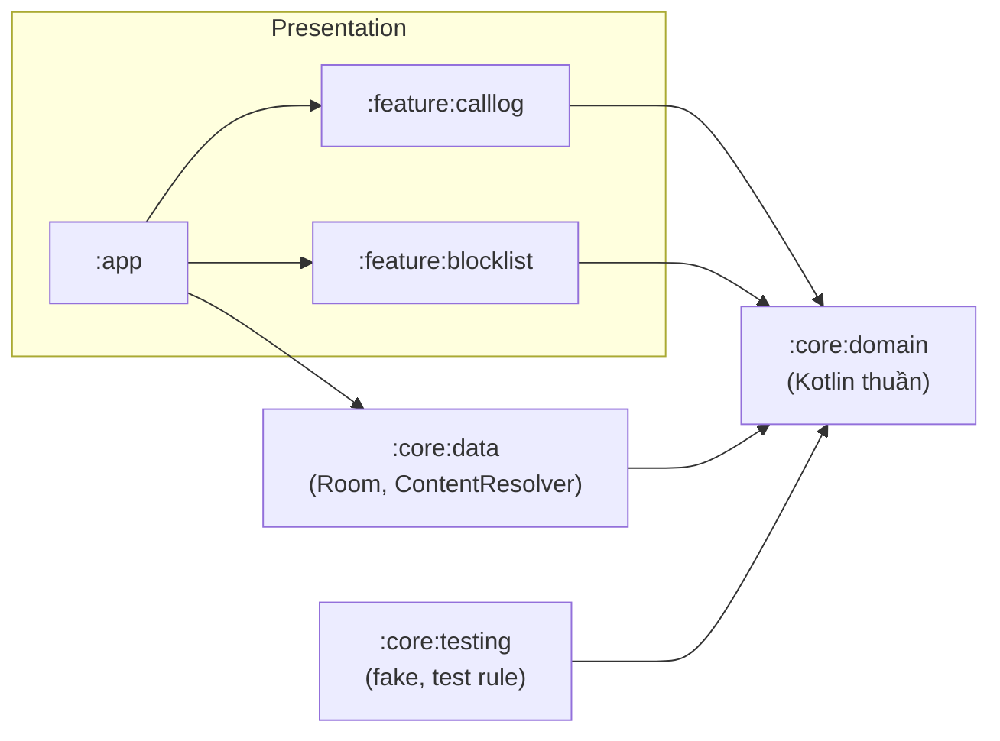

# Kiến trúc SpamGuard Lite

## Tóm tắt

Có 3 tầng, và phụ thuộc chỉ đi **từ ngoài vào trong**:

- **Presentation**: `feature/*`, `app`
- **Domain**: `core/domain`, viết bằng Kotlin thuần, không biết gì về Android
- **Data**: `core/data`

Tầng domain định nghĩa interface, tầng data cài đặt interface đó, và Hilt nối hai bên lại với nhau.



Feature module **không** phụ thuộc `:core:data`. Feature chỉ biết use case và interface repository trong domain.

## Luồng dữ liệu (UDF)

Lấy ví dụ màn hình **Cuộc gọi**:

```
CallLogFragment ──onPermissionResult()──▶ CallLogViewModel
      ▲                                        │ GetClassifiedCallsUseCase(limit)
      │ uiState: StateFlow<CallLogUiState>     ▼
      └──────── render(state) ◀── CallUiMapper ◀── Flow<List<ClassifiedCall>>
                                                     │
                       CallLogRepository ◀───────────┤ (đọc 1 lần)
                       BlockRuleRepository.observeRules() (phát lại khi quy tắc đổi)
```

- **Fragment** chỉ làm 3 việc: gửi sự kiện lên ViewModel, collect `uiState` bằng `repeatOnLifecycle(STARTED)`, và gọi `render(state)`. Trong Fragment không có logic nghiệp vụ.
- **ViewModel** giữ trạng thái màn hình trong `StateFlow`. Trạng thái của mỗi màn hình được mô tả bằng một kiểu duy nhất (`CallLogUiState`, `BlocklistUiState`).
- **Mapper** (`CallUiMapper`, `BlockRuleUiMapper`) chuyển model domain thành model hiển thị: định dạng thời gian, chọn icon, chọn chuỗi. Nhờ vậy ViewModel gọn và mapper test được riêng.
- **Use case** chỉ làm một việc, gọi qua `operator fun invoke`.
- **Repository impl** đổi dữ liệu thô (Cursor, Entity) thành model domain, và đổi lỗi hạ tầng thành lỗi domain (`CallLogUnavailableException`).

## SOLID trong repo

| Nguyên tắc | Ở đâu |
| --- | --- |
| **S**: một lý do để thay đổi | `PhoneNumberNormalizer` chỉ chuẩn hóa số; `SpamClassifier` chỉ phân loại; `AddBlockRuleUseCase` chỉ thêm quy tắc; mapper chỉ định dạng hiển thị |
| **O**: mở rộng không sửa | Kiểu so khớp là chiến lược `BlockRuleMatcher`. Thêm kiểu mới thì thêm `MatchType` và một matcher, không phải sửa `SpamClassifier` |
| **L**: thay thế được | `FakeCallLogRepository` và `FakeBlockRuleRepository` thay hoàn toàn cho bản thật trong test |
| **I**: interface nhỏ | `CallLogRepository` (đọc) tách khỏi `BlockRuleRepository` (đọc/ghi); `CallLogDataSource` chỉ có 1 hàm |
| **D**: phụ thuộc vào trừu tượng | Domain định nghĩa interface; `DataModule` dùng `@Binds` nối impl. `Clock`, `ZoneId`, `CoroutineDispatcher` đều được inject thay vì gọi trực tiếp |

## Quy ước

- **Trạng thái UI**: dùng `StateFlow` và `repeatOnLifecycle`. Không dùng LiveData.
- **Thông báo một lần** (ví dụ snackbar): đặt trong UI state (`userMessageRes`). UI hiển thị xong thì gọi `onUserMessageShown()`.
- **Kết quả từ dialog**: dùng Fragment Result API (`setFragmentResult` / `setFragmentResultListener`). Dialog phải có constructor rỗng; dữ liệu đi qua `arguments` và bundle kết quả.
- **ViewBinding**: không lưu binding vào field của Fragment. Tạo binding trong `onViewCreated` rồi truyền vào hàm `render`.
- **Lỗi**: ViewModel chỉ bắt các lỗi domain đã biết. Lỗi lập trình phải để lộ ra, không nuốt.
- **Chuỗi hiển thị**: luôn đặt trong `strings.xml`, tên có tiền tố theo module (`call_log_*`, `blocklist_*`).
- **Dữ liệu cá nhân**: không log số điện thoại hay tên danh bạ. Test dùng dữ liệu giả.
- **Visibility**: implementation trong `core/data` để `internal`, chỉ interface domain là public.

## Thêm một màn hình mới

1. Tạo module `feature/<tên>` (sao chép `build.gradle.kts` của `feature/blocklist`), rồi thêm vào `settings.gradle.kts`.
2. Domain: thêm use case (và interface repository nếu cần).
3. Data: cài đặt repository rồi `@Binds` trong `DataModule`.
4. Feature: viết `UiState`, `UiMapper`, `ViewModel`, `Fragment`, layout, `strings.xml`; test cho ViewModel và mapper.
5. App: thêm destination vào `nav_graph.xml` và item vào `bottom_navigation.xml`.
